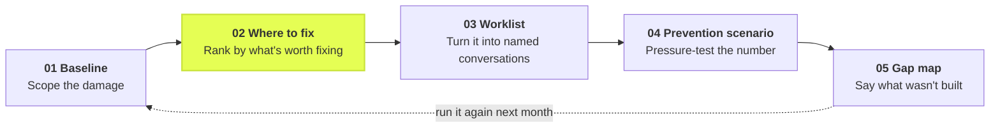

# Case study 01 — Exception Recurrence Lab

**Area:** Ramp Bill Pay · **Discipline:** Product Operations · **Date:** 26 October 2026
**Author:** Shruti Kakar · **Status:** independent, unofficial, synthetic data only

A short account of how I looked for a gap in a product I do not work on, what I
built to test whether the gap mattered, and the two findings that argued against
my own pitch.

---

## Why I chose this problem: from audit and risk to product

At JPMorgan Chase, I've worked at the intersection of financial data, audit,
risk, and technology, where I've seen firsthand how much operational effort
goes into identifying, investigating, and resolving exceptions.

My work has involved validating financial workflows, investigating
inconsistencies across multiple systems, and testing AI-driven processes to
ensure they produce accurate, reliable results. Through Python and Alteryx
automation, I've helped reduce manual validation effort by approximately 40%,
while also developing testing approaches for multi-agent workflows.

One thing that stood out to me was that resolving an exception doesn't
necessarily prevent it from happening again. Teams can spend significant time
investigating individual issues without always having a systematic way to
connect those issues to recurring upstream causes.

That experience shaped how I approached Ramp's Bill Pay product. Ramp has
already built sophisticated capabilities around detecting anomalies, reviewing
invoices, and enforcing financial controls — more sophisticated than I gave it
credit for on a first pass, see below. I was interested in exploring what
could come next: could exception history become a feedback loop that helps
finance teams identify recurring problems, prioritize preventative changes,
and measure whether those interventions work?

This project brings together two parts of my experience that I particularly
enjoy: the rigor of financial controls and the creativity of building
products. Having worked on the validation and risk side, I'm drawn to building
tools that don't just identify problems, but help prevent them at scale.

## 1. The workflow

Before the findings, the shape of the thing. The five tabs in the app aren't
five separate reports — they're one sitting, in order, the way a Product Ops
reviewer would actually work through a month's exception backlog. Everything
in the sections that follow is one of these five steps, examined in detail.



The *Where to fix* step is highlighted because it's the move the rest of this
project is built around — see §4. Running the loop monthly is what would tell
you whether last month's fix actually moved anything.

## 2. How I looked for the gap, and how that research evolved

I started from a constraint rather than an idea: I have no access to Ramp's
internals, so anything I claim has to be falsifiable from public material and
honest about what it cannot see. That turned out to matter twice — once for
Ramp's internals, and once for my own first pass at the research.

### The first pass, and what it got wrong

The earliest version of this research read Ramp's public material at the
surface level — invoice field extraction, a needs-review queue, "AI approval
recommendations," approval routing, audit history — and concluded that nothing
public treated an exception's *recurrence* as the unit of work. That
conclusion was directionally right but the picture behind it was too coarse.
It described Ramp's surfaces the way a user manual would, not the way the
actual product behaves.

### The second pass: what Ramp actually ships

Reading the live pages and the live API schema directly, rather than a
category list, changes the picture:

| Public Ramp capability | What it does | Relevance to this project |
| --- | --- | --- |
| [Bill Pay: Needs Review](https://support.ramp.com/managing-bills-and-payments-on-bill-pay) | Central queue for payments requiring intervention, including missing information | Already provides exception triage |
| [AP Review Agent](https://support.ramp.com/ap-agents-available-in-ramp-bill-pay) | Uses policies, contracts, POs, and supporting documents to flag inconsistent bills, editable through Ask Ramp | Already detects many invoice exceptions |
| Approval Intelligence | AI summaries, anomaly flags, recommendations, historical spending context | Already assists human reviewers |
| Smart OCR and auto-coding | Extracts invoice data and learns GL coding from historical corrections | Already addresses missing and incorrect GL coding |
| [Bill Pay submission policies](https://support.ramp.com/bill-pay-set-up) | Validates required information, flags violations, records overrides | Already enforces preventive controls |
| [Audit Logs API](https://docs.ramp.com/developer-api/v1/api/audit-logs) and Bills/Vendors APIs | Records workflow events; agent attribution added in the September 2026 changelog | Potential foundation for recurrence analysis — see §6 |

Fetching [support.ramp.com/ap-agents-available-in-ramp-bill-pay](https://support.ramp.com/ap-agents-available-in-ramp-bill-pay)
directly turned up a detail the first pass missed entirely: Ramp's fraud
detection already flags suspicious duplicate invoices. That overlaps this
project's "duplicate invoice" root cause directly, and it's exactly the kind
of fact a surface-level read skips past.

Building a basic LLM that recommends invoice corrections, or a dashboard of
flagged invoices, would now substantially overlap existing Ramp product. That
wasn't as obvious before this second pass, which is the whole reason the
revision matters: the first version of this project would have proposed
rebuilding something that already exists.

### What narrowed, not what disappeared

The gap didn't vanish under scrutiny. It got more precise. I could not verify
a customer-facing Ramp feature that does all four of the following *together*:

1. Groups historical exceptions into recurring root-cause patterns.
2. Estimates which patterns create the most avoidable operational work.
3. Recommends upstream process changes based on those patterns.
4. Tracks whether those changes actually reduce recurrence over time.

That four-part definition, not the vaguer "recurrence as the unit of work"
from the first pass, is what this prototype actually tests. Any one or two of
those four may already exist privately inside Ramp, or spread across
analytics and workflow features this research can't see. Absence from public
documentation is evidence about documentation, not about the product — true on
the first pass, and still true on the second, more careful one.

**How I'd position this to Ramp**, after both passes:

> Ramp has built strong capabilities for invoice intake, detecting anomalies,
> enforcing policies, and managing reviews. Based on my experience
> investigating exceptions at JPMorgan, I wanted to explore the next
> operational question: how can the historical patterns behind those
> exceptions help teams prioritize preventative changes? I built an
> independent prototype to test that hypothesis and identify what additional
> customer evidence would be needed.

A proposed product improvement informed by public research, not a claimed
discovery. Full source-by-source verification, including which claims are
checked against a live page and which were carried from an earlier pass
without independent re-verification, is in [`ASSUMPTIONS.md`](ASSUMPTIONS.md).

## 3. The hypothesis

> Operations teams spend a measurable share of review effort on exceptions they
> have already seen from the same vendor for the same reason. If that share is
> both large and concentrated, ranking root causes by *preventability* rather
> than by volume changes which fix a team ships first.

Two conditions have to hold for this to be worth building. The repeat share has
to be large, and the repeats have to concentrate in a short list of vendors. If
repeats were rare, or spread evenly across hundreds of vendors, the thesis fails
and the right answer is to keep improving case resolution.

## 4. What I built

A Python and Streamlit application over a reproducible 300-record synthetic
dataset: six months, 36 vendors, 7,962 bills processed, five root causes.

The modelling decisions are the substance, and each is arguable on purpose.

**Only repeats are addressable.** A recurrence cluster is one vendor and one root
cause. The first occurrence in a cluster is excluded from the addressable pool,
because no feedback loop can prevent a problem the first time it is ever seen.
This single rule is what separates the tool from a category counter, and it cuts
the apparent opportunity by more than a third.

**Concentrated causes are cheaper to fix.** For each cause I measure the share of
its repeat hours sitting with its three heaviest vendors. A cause driven by three
vendors is a conversation. The same hours spread across thirty vendors is a
platform change.

**Causes differ in how fixable they are at all.** A required-field rule at
submission can remove most missing-PO cases. Nothing resembling a form rule will
remove duplicate invoices, which need matching. That difference lives in a
documented prior per cause, and it is the weakest number in the project.

The ranking multiplies the three: addressable repeat hours per month ×
concentration × fixability. The naive volume ranking is kept on screen beside it,
because where the two agree, this tool adds nothing.

## 5. What the prototype found

### The repeat share is large and highly concentrated

| Measure | Value |
| --- | --- |
| Exceptions in the window | 300 |
| Share that are repeat occurrences | 63% |
| Total reviewer hours | 118 |
| Addressable reviewer hours (repeats only) | 75 |
| Recurring vendor/cause pairs | 51 of 110 |
| Share of repeat hours in the top 10 pairs | 73% |
| Repeat exceptions per 1,000 bills | 23.9 |

Both conditions hold in this dataset, which is the expected result: I generated
the data with that structure deliberately, and the generator says so in its
docstring. The finding is not that recurrence is concentrated in the real world.
The finding is that *if* it is, the worklist is ten vendor conversations rather
than a platform programme — and that is a cheap thing to check against real data
before committing to anything.

### The ranking disagrees with the volume ranking, and the disagreement is the point

| Rank | Root cause | Repeat h/month | Concentration | Fixability | Index | Rank by volume |
| --- | --- | --- | --- | --- | --- | --- |
| 1 | Missing PO | 3.74 | 67% | 0.80 | 2.02 | 1 |
| 2 | Vendor details | 2.65 | 85% | 0.70 | 1.58 | 3 |
| 3 | GL coding | 2.27 | 80% | 0.65 | 1.18 | 2 |
| 4 | Duplicate invoice | 3.15 | 84% | 0.35 | 0.93 | 4 |
| 5 | Approval routing | 0.77 | 92% | 0.55 | 0.39 | 5 |

Duplicate invoices are the second-largest addressable pool at 3.15 reviewer hours
a month, ahead of GL coding and vendor details. They rank fourth to act on,
because the upstream control is genuinely hard. Vendor details and GL coding swap
places. A team working purely from a volume report would start in the wrong
place twice over.

### Finding that argued against the pitch: the labour-savings case does not survive contact with the arithmetic

Total addressable effort is 12.6 reviewer hours a month. At a 10% prevention
assumption that is 1.3 hours a month, about **$724 a year** at a loaded reviewer
cost of $48 an hour. For one mid-market accounts-payable team, that is not a
business case. It is a rounding error.

I built the model expecting it to support an efficiency pitch and it does not. So
the pitch has to change rather than the number. The defensible versions are:

- **Platform aggregation.** The same analysis across a customer base is a product
  insight about which submission controls to build, not a per-customer saving.
- **Cycle time, not headcount.** Median time to resolution is 23 hours and the
  reopen rate is 12%. Bills that stall and bills that come back are the costs
  that an AP team actually feels.
- **Risk.** Duplicate invoices and vendor banking details are fraud-adjacent.
  Their value is not measured in reviewer minutes.

Any version of this project that leads with hours saved at a single customer is
overstating what the model supports.

### Finding that broke the plan: a 30-day pilot cannot measure the primary metric

My own PRD proposed a four-week experiment measuring recurrence per 1,000 bills.
I wrote the sample-size calculation into the tool to check it, and the plan does
not survive.

| Relative improvement to detect | Bills per arm | Months of volume per arm |
| --- | --- | --- |
| 20% | 14,483 | 10.9 |
| 30% | 6,087 | 4.6 |
| 50% | 1,938 | 1.5 |

At 80% power and a 5% significance level, detecting a 20% improvement in the
recurrence rate needs about 14,500 bills per arm. This team processes roughly
1,300 bills a month. One arm would take eleven months to fill. Even a 50%
improvement — implausibly large — needs six weeks.

The experiment has to change, in one of three ways: pool several customers into
one study, pick a cohort an order of magnitude larger, or judge the 30-day window
on a leading indicator such as the share of exceptions caught before review and
read recurrence only later. I would choose the third, and I would say up front
that the 30-day result is directional.

This is the finding I would lead with in an interview. Not because the maths is
hard, but because writing the power check into the tool is what turned a
plausible-sounding plan into a wrong one, before anyone spent a month on it.

## 6. A real data foundation: Ramp's own APIs

Everything above runs on a synthetic CSV because that's what an outsider can
responsibly build. But the most useful discovery in the second research pass
wasn't a capability gap — it was that Ramp already exposes a plausible data
foundation for this, publicly, in its developer API.

**The Audit Logs API.** `GET /developer/v1/audit-logs/events` returns a record
of actions by users, agents, and integrations, filterable by date, type, user,
and resource. I read the live schema directly rather than take that summary on
faith, and two details stood out:

- Every event carries an `actor_type` — `policy_agent`, `spend_request_agent`,
  `ramp`, or `user` — plus an `agent_details.agent_name` field. That's the
  agent-attribution capability the September 2026 changelog added, and it
  means a real integration could already tell which exceptions a human closed
  versus which an AI agent handled.
- The event-type enum includes an `Exception` family — `Exception requested`,
  `Exception request approved`, `Exception request denied`. Reading the full
  enum rather than the name alone shows these are **policy-limit override
  exceptions** (someone requesting an exception to a spend or approval rule),
  **not invoice-processing exceptions** like a missing PO or a GL miscode. The
  two are easy to conflate from the outside, and the audit log doesn't use the
  word the way this project does.

**The Bills and Vendors APIs.** `GET /developer/v1/bills` returns
`accounting_field_selections`, `approval_status`, `bill_owner`, and vendor
linkage — but no field resembling this project's `root_cause` or
`minutes_spent`. That absence is informative on its own: if Ramp has an
internal recurrence-analysis layer, it isn't simply reading a label off this
endpoint. It would have to be inferred.

**What a real version of this project would have to do differently.** Instead
of a `root_cause` column, infer recurrence from proxies: repeated
`Violation from rule` events against the same vendor, repeated
`Bill pay submission policy updated` exemptions, or clusters of
`Exception requested` events tied to the same cost center. That's a weaker
signal than a labelled column, and a real build would need to validate it
against cases an AP admin actually agrees were the same recurring problem
before trusting the inference — which is exactly the kind of validation this
synthetic prototype was built to avoid needing, and a real one couldn't skip.

This is logged as `MILESTONES.md` M9, sequenced after the operator interviews
in M8 on purpose: building an inference layer before anyone has confirmed
recurrence is the right lens would be solving a problem no operator has
validated, with real API complexity standing in for real evidence.

Conceptual architecture only, not an existing Ramp integration, and not
something this project has the customer access to build:

```
Ramp Bills API ──┐
Ramp Vendors API ─┼─→  recurrence inference  →  root_cause_table()  →  this app's
Ramp Audit Logs ──┘        (new, M9)             (unchanged, src/analytics.py)    5 tabs
```

The right-hand side of that diagram — the ranking, the worklist, the scenario
model, the power check — is already built and tested against synthetic data.
What's missing is the left-hand side: authorized customer access, API
permissions, and a validated way to turn audit events into the same shape the
rest of the app already expects.

## 7. What my own model gets wrong

**The prevention index cannot see reopens.** Approval routing has the highest
reopen rate in the dataset at 23%, nearly double every other cause, and the model
ranks it last because it is cheap in reviewer minutes. A cause that keeps coming
back after being closed is a different kind of cost and my scoring function is
blind to it. It is logged as M6 in `MILESTONES.md` and deliberately not fixed:
adding a fourth factor to a scoring model that no operator has validated makes it
look more sophisticated without making it more right.

**The fixability priors are my estimates.** Five numbers between 0.35 and 0.80,
sourced from my own judgement about AP workflows. They move the ranking. Until
five operators have argued with them they are the softest part of the project,
which is why they sit in one named dictionary in `src/config.py` rather than
buried in the scoring code.

**Synthetic data is tidy and real exception data is not.** Every record here has
exactly one root cause. Real cases are ambiguous, multi-cause and sometimes
mislabelled by whoever closed them. A real version needs multi-label support and
a record of how each cause was validated.

**Root cause is a label, not a diagnosis.** The dataset treats the cause as
known. In practice someone inferred it from a symptom, and the inference can be
wrong in a way that quietly misdirects every number downstream.

## 8. What I would do next, in order

1. **Five operator interviews.** Are these the real causes? Does recurrence feel
   like the problem, or is it cycle time? What would you do with the worklist?
   Replace my priors with their answers. Nothing else should move first.
2. **Re-rank on whatever they say the cost actually is.** If they say reopens, the
   model gets a reopen factor and the ranking changes.
3. **Rewrite the experiment** around a leading indicator, with the power
   calculation shown rather than assumed.
4. **Then, and only then, the AI layer.** `reviewer_note` plus `root_cause` is
   already a labelled evaluation set, so a classifier can be measured against a
   keyword baseline rather than demoed. It is the most impressive-looking
   addition and the least evidence-backed, so it goes last.
5. **Only with real customer access, the real data foundation.** Swap the
   synthetic CSV for Ramp's Audit Logs, Bills and Vendors APIs (§6), inferring
   recurrence from event proxies instead of a labelled column, and validate
   that inference against cases an AP admin actually agrees are the same
   recurring problem before trusting it.

## 9. What this is not

No Ramp integration, no authentication, no real customer data, no AI inference,
no measured savings. Every figure in this document comes from synthetic data
generated by `src/generate_data.py` with a fixed seed, and the generator builds in
the recurrence pattern the app then finds. The contribution is the method and the
two findings that cut against the original pitch, not the numbers.

Nothing here uses or refers to any proprietary information from a current or
former employer.

## Reproducing every number in this document

```
make install
make data
make test
make app
```

`make test` runs 58 tests. The figures in section 5 come from the bundled seed,
so they will match exactly. Section 2's capability table and section 6's API
schema findings are cited to live Ramp pages instead — see `ASSUMPTIONS.md` for
exactly which claims were fetched directly versus carried from an earlier pass.
