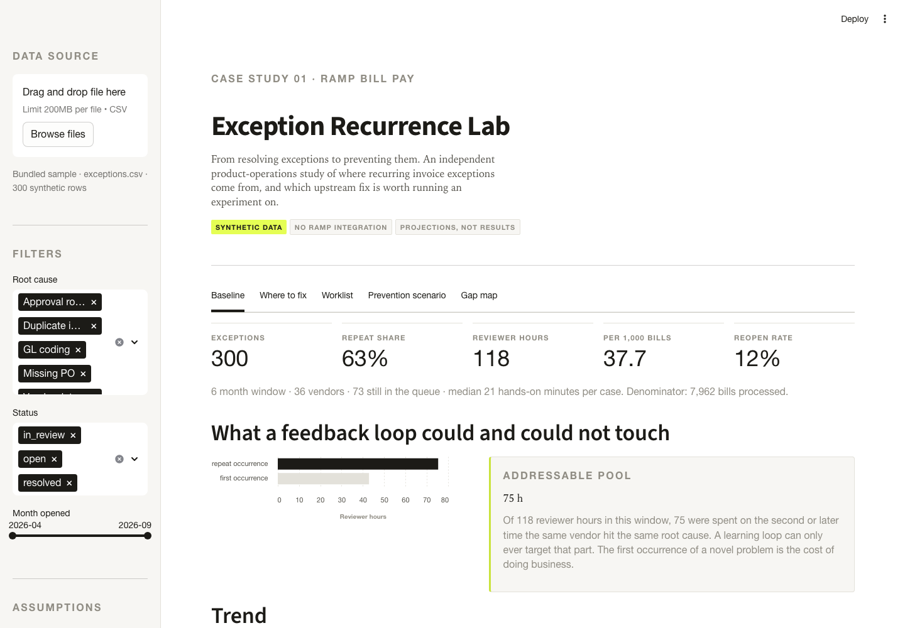
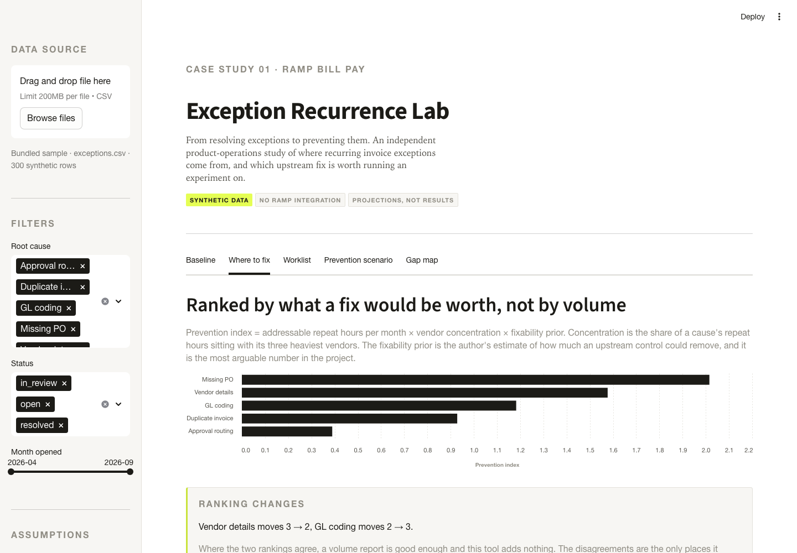
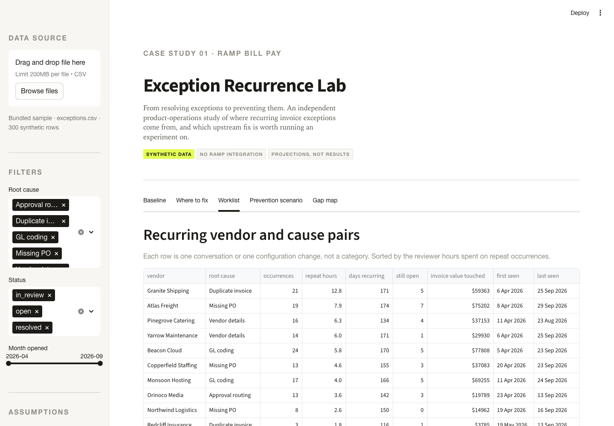
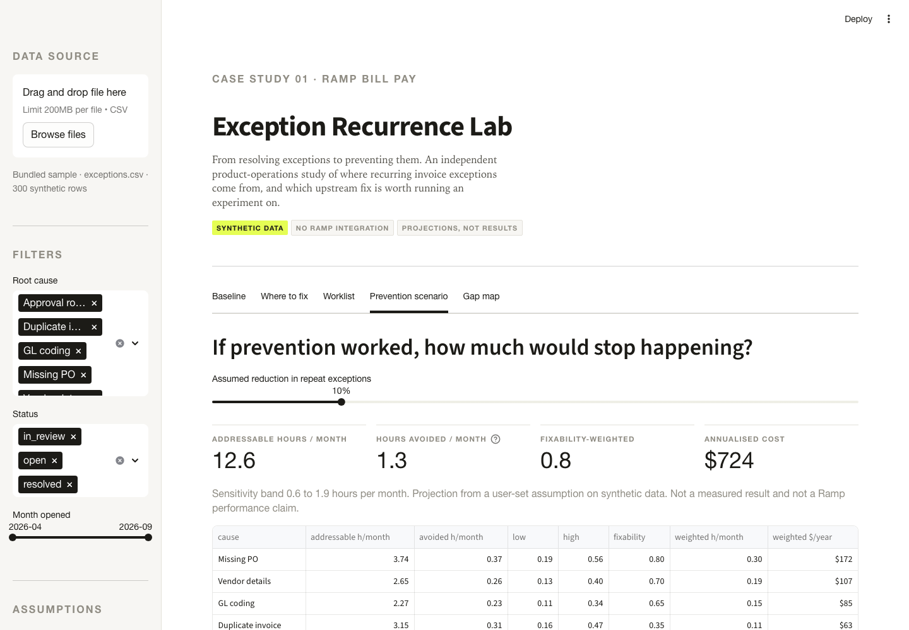
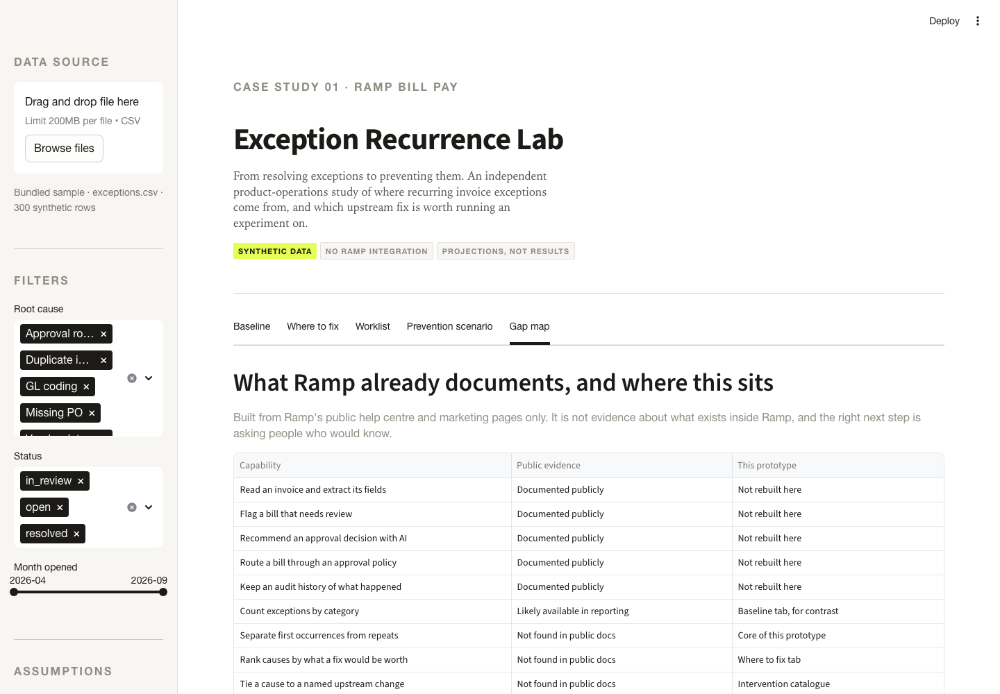

# Exception Recurrence Lab

**From resolving exceptions to preventing them.**

**[Try the live app →](https://ramp-exception-recurrence-lab.streamlit.app/)** ·
**[Read the case study →](https://claude.ai/code/artifact/f726b061-be17-48fb-a1a8-bca46d42ea0f)**

An independent product-operations case study on [Ramp](https://ramp.com)
[Bill Pay](https://ramp.com/accounts-payable). It asks a single question: once
an invoice exception has been resolved, what makes the same exception stop
happening — and which upstream fix is worth running an experiment on first?

Not affiliated with Ramp. All data is synthetic. No figure in this project is a
measured result.

```
make install && make data && make test && make app
```

---

## Use case, in one glance

| | |
| --- | --- |
| **Problem** | Repeated exceptions keep consuming review time even after each individual case gets resolved |
| **Who's asking** | Product Operations at a Bill Pay-type platform, an AP admin working the queue, or a controller deciding what to fix next |
| **What they do here** | Open the app, see which root cause is both expensive *and* preventable, pull the specific vendor conversations behind it, and pressure-test any fix before committing budget to a pilot |
| **What it replaces** | A spreadsheet pivot sorted by exception count — which answers "what's biggest," not "what's worth fixing" |
| **What it is not** | A Ramp product, a Ramp integration, or a claim about what Ramp's internal tooling does or doesn't already do |

The five tabs walking through that loop, with screenshots, are in
[How I'd actually use this](#how-id-actually-use-this) below. Every number on
screen traces back to a file or a cited source — see
[`ASSUMPTIONS.md`](ASSUMPTIONS.md).

## Why this and not an exception detector

Ramp already ships a [Needs Review queue](https://support.ramp.com/managing-bills-and-payments-on-bill-pay),
an [AP Review Agent](https://support.ramp.com/ap-agents-available-in-ramp-bill-pay)
that checks bills against policy and supporting documents, AI anomaly flags,
[submission policies](https://support.ramp.com/bill-pay-set-up) that validate
required fields, and an [Audit Logs API](https://docs.ramp.com/developer-api/v1/api/audit-logs)
with agent attribution. I verified each of those directly against a live page
or the live API schema rather than assuming them — the full capability table
and an earlier, coarser read of this same research that I had to correct are
both in [`CASESTUDY.md`](CASESTUDY.md#2-how-i-looked-for-the-gap-and-how-that-research-evolved).
Building another exception detector or a basic LLM invoice-correction bot would
now substantially overlap what's already shipped.

What I could not find, across any of that, is a feature that does all four of
these together: group historical exceptions into recurring root-cause
patterns, estimate which patterns cost the most avoidable work, recommend an
upstream change per pattern, and track whether that change actually reduced
recurrence. That four-part gap, not a vaguer "nothing treats recurrence as the
unit of work," is what this prototype tests.

Absence from public docs is evidence about documentation, not about the
product. This is a proposed product improvement informed by public research,
not a claimed discovery — and Ramp's own Audit Logs, Bills, and Vendors APIs
are a credible real foundation for it, detailed in `CASESTUDY.md` §5.

## What it does

Five views over a reproducible synthetic exception history.

| View | What it answers |
| --- | --- |
| **Baseline** | How much review effort is spent on problems already seen, and is the repeat rate moving |
| **Where to fix** | Which root cause is worth fixing, ranked by preventability rather than volume, with a named upstream change for each |
| **Worklist** | Which specific vendor and cause pairs keep recurring, down to the individual cases |
| **Prevention scenario** | What a prevention assumption would be worth, banded, and whether a pilot could actually detect it |
| **Gap map** | What Ramp publicly documents, what this prototype adds, and what it deliberately does not do |

## The modelling decision that matters

A **recurrence cluster** is one vendor plus one root cause. The first occurrence
in a cluster is excluded from the addressable pool, because no feedback loop can
prevent a problem the first time it is ever seen. In the bundled dataset that
rule cuts 118 reviewer hours down to 75 addressable ones.

Causes are then ranked by a **prevention index**:

```
prevention index = addressable repeat hours per month
                 x vendor concentration      (share of repeat hours in the top 3 vendors)
                 x fixability prior           (how much an upstream control could remove)
```

The volume ranking stays on screen next to it. Where the two agree, this tool
adds nothing; the disagreements are the only place it earns its keep.

## How I'd actually use this

I didn't design the five tabs as five separate reports. They're one sitting,
in order, the way I'd expect a Product Ops reviewer to actually work through a
month's exception backlog. Here's that sitting, with the app's own output at
each step.

**Start with the damage, not the detail.** Open the app and the Baseline tab
is waiting with the whole window already summarized: 300 exceptions, 63%
repeats, 118 reviewer hours, 12% of closed cases reopening. That last number is
the one I look at first, because a reopen is worse than a slow resolution — it
means someone closed the case and was wrong. The chart underneath splits those
118 hours into what a feedback loop could touch and what it couldn't: 75 hours
sat on problems the team had already seen before.



**Then ask which fire to put out first — not the biggest, the most worth
fighting.** This is the move the whole project is built around. The Where to
fix tab doesn't just sort root causes by how many exceptions they generated;
it multiplies addressable repeat hours by how concentrated the problem is
among a handful of vendors and by how fixable the cause plausibly is at all.
Missing PO stays on top either way, but vendor details and GL coding swap
places once concentration enters the picture, and duplicate invoices — the
second-biggest pool of repeat hours — drop to fourth because nothing short of
real matching logic removes them. I keep the naive volume ranking printed
right next to it on purpose: if the two agree, I didn't need the fancier
model.



**Turn the ranking into a worklist a human can actually run.** A root cause
is an abstraction; a vendor is a phone call. The Worklist tab drills from
"missing PO" down to the 19 times Atlas Freight specifically did it, when
each case opened, and whether it's still sitting open. This is the view I'd
hand to the AP admin who owns vendor relationships — not "fix GL coding" but
"here are the six vendors responsible for most of it, ranked by hours spent."



**Before promising anyone a number, stress-test the number.** The Prevention
scenario tab is where I made myself uncomfortable. Move the slider to a 10%
reduction assumption and the app does the arithmetic honestly: 1.3 hours a
month, banded low-to-high, translated into an annualized cost. It also runs
the sample-size math for whatever pilot window you're proposing, which is how
I caught my own PRD proposing a 30-day experiment that would need eleven
months of bill volume to actually detect a 20% improvement. I'd rather find
that out moving a slider than three weeks into a pilot.



**Close by naming what you didn't just build.** The Gap map tab is the
honesty check, laid out as a table: what Ramp already documents publicly,
what this prototype adds on top, and where the two overlap. It's the page I'd
put in front of a skeptical reviewer first, because it says plainly that this
is not a Bill Pay rebuild — it's one layer, tested against one hypothesis,
with everything else left where Ramp already has it covered.



That's the loop: scope the damage, rank what's worth fixing, turn the winner
into a worklist, pressure-test the number before anyone commits to it, and say
out loud what you didn't build. Running it monthly is what would tell you
whether last month's fix actually moved anything.

## Who reaches for this, and when

Three people would open this tool, and they'd open it for different reasons.

**The Product Ops lead picking next quarter's bet.** They own a backlog of
possible workflow improvements and a limited number of engineering favors they
can call in. The Where to fix tab is built for exactly that moment — not "what
takes the most time" but "what's both expensive and actually fixable" — so the
case for shipping a PO-required submission check over a duplicate-detection
model is made with a number instead of a hunch.

**The AP admin who's tired of chasing the same three vendors.** They don't
need a root-cause taxonomy; they need to know whether it's worth the
awkward conversation with Pinegrove Catering about vendor records again. The
Worklist tab answers that directly — named vendor, named cause, hours spent,
whether it's still open — which is the form the fix actually takes before it's
a policy change.

**The person about to greenlight a 30-day pilot.** This is the case I built
for myself and didn't expect to need. Before committing reviewer time and a
controller's attention to an experiment, the Prevention scenario tab's power
check answers the question that usually gets skipped: at this volume, could
the proposed window even detect the effect you're hoping for? Here, the
honest answer was no, and that's the finding that actually changed the plan.

## Two findings that argued against the pitch

**The labour-savings case does not hold at single-customer scale.** Total
addressable effort is 12.6 reviewer hours a month. At a 10% prevention
assumption that is about $724 a year. The case has to be made on cycle time,
reopen rate, fraud exposure or platform-wide insight — not on hours saved.

**A 30-day pilot cannot measure the primary metric.** Detecting a 20%
improvement in the recurrence rate at 80% power needs roughly 14,500 bills per
arm. The modelled team processes 1,300 bills a month, so one arm would take
eleven months to fill. The power check is built into the app, and it is what
turned my own proposed experiment into a wrong one before anyone ran it.

`CASESTUDY.md` has the full reasoning, including what the model gets wrong.

## Run it

Requires Python 3.9 or newer.

```bash
make install      # create .venv and install dependencies
make data         # generate the synthetic dataset, fixed seed
make test         # 58 tests
make app          # open the Streamlit app
```

Without `make`:

```bash
python3 -m venv .venv && .venv/bin/pip install -r requirements.txt
.venv/bin/python -m src.generate_data
.venv/bin/python -m pytest -q
.venv/bin/streamlit run app.py
```

The generated CSVs are gitignored. If they are missing, the app rebuilds them on
first load, so `streamlit run app.py` works from a fresh clone and on a hosted
deployment with no build step.

Bring your own CSV through the sidebar uploader. The required columns are the
ten in `src/config.py`; the loader reports every schema problem at once rather
than failing on the first. [`examples/sample_exceptions.csv`](examples/sample_exceptions.csv)
is a 40-row file in the exact expected shape — a clean upload to try the loader
against, with a repeat cluster, an open case, and a reopened case already in it
so the interesting views aren't empty on first upload.

## Deploy

`app.py` runs on Streamlit Community Cloud with no configuration: point it at
this repository, set the entrypoint to `app.py`, and the dataset regenerates on
first load. The app reads no secrets and makes no network calls.

## Repository map

| Path | Purpose |
| --- | --- |
| `PRD.md` | Product requirements, written before any code |
| `CASESTUDY.md` | Findings, including what the model gets wrong — [read the formatted version](https://claude.ai/code/artifact/f726b061-be17-48fb-a1a8-bca46d42ea0f) |
| `ASSUMPTIONS.md` | Every number traced to its source: computed, assumed, or cited, with links |
| `MILESTONES.md` | Build sequence, remaining work, and the context budget |
| `DESIGN.md` | Visual system, and why Ramp's real typefaces are not bundled |
| `AGENTS.md` | Working rules for anyone or anything editing this repo |
| `examples/sample_exceptions.csv` | A clean 40-row file to try the uploader against |
| `src/config.py` | Every arguable assumption, each with its source |
| `src/generate_data.py` | Fixed-seed synthetic data, stdlib only |
| `src/loader.py` | Strict CSV ingestion and schema validation |
| `src/analytics.py` | Recurrence model, concentration, prevention ranking |
| `src/scenario.py` | Banded projections and pilot sample size |
| `src/interventions.py` | Candidate upstream change per root cause |
| `app.py` | Streamlit interface |
| `tests/` | 58 tests, including an end-to-end app run |
| `assets/ramp.css` | Design tokens, mirrored in `src/theme.py` |

## Limits

No Ramp integration. No authentication. No real customer data. No AI inference.
No measured savings. The dataset is generated with a recurrence pattern built in,
so the pattern the app finds is the one it was given. The contribution is the
method and the findings that cut against the original pitch.

Every figure above, and every assumption behind it, is traced in
[`ASSUMPTIONS.md`](ASSUMPTIONS.md) — including which claims about Ramp's
actual product are independently verified against a live page and which are
carried from the original brief without re-checking.

Nothing here uses or refers to proprietary information from any current or former
employer.
